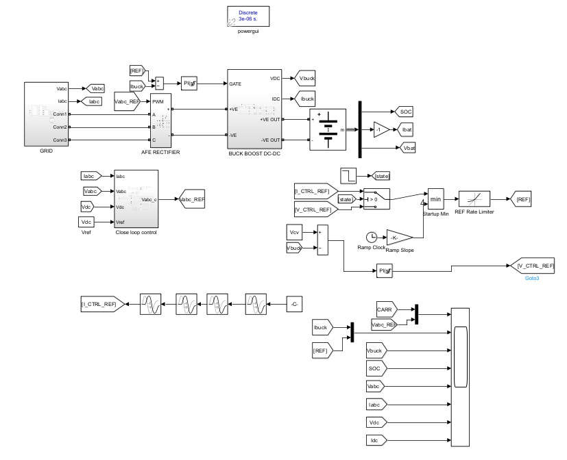
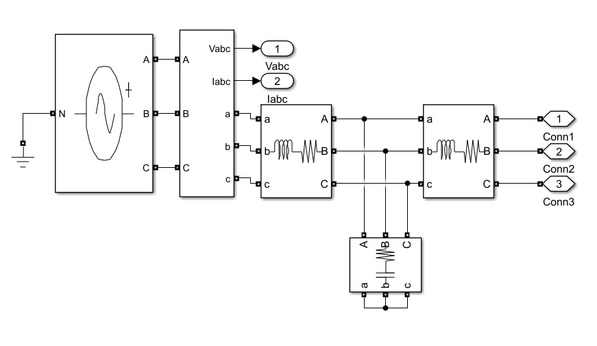
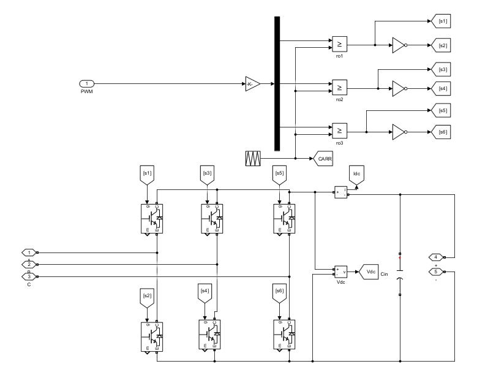
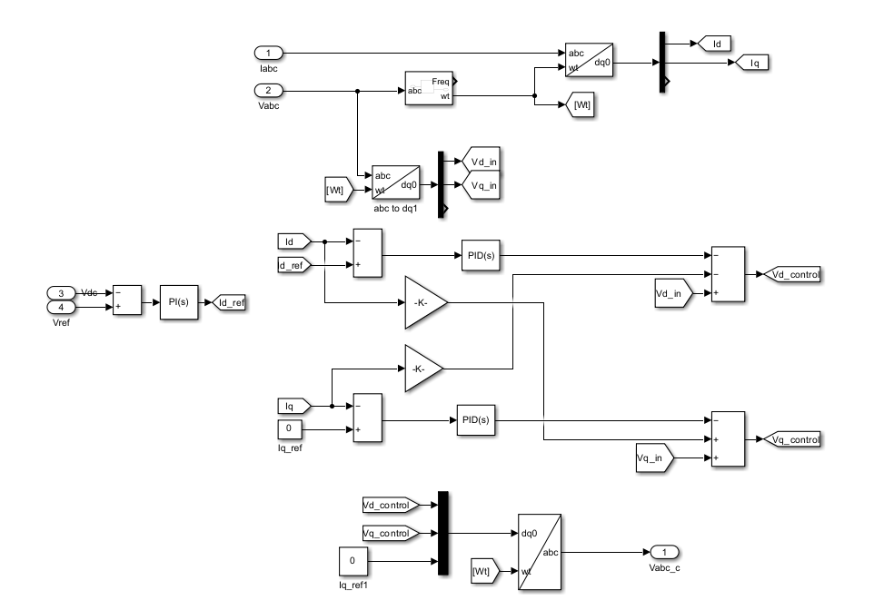
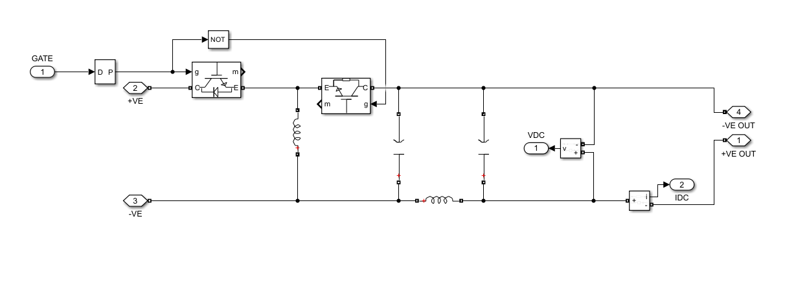
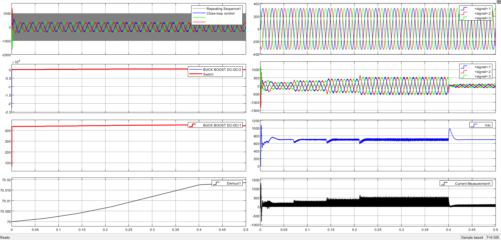
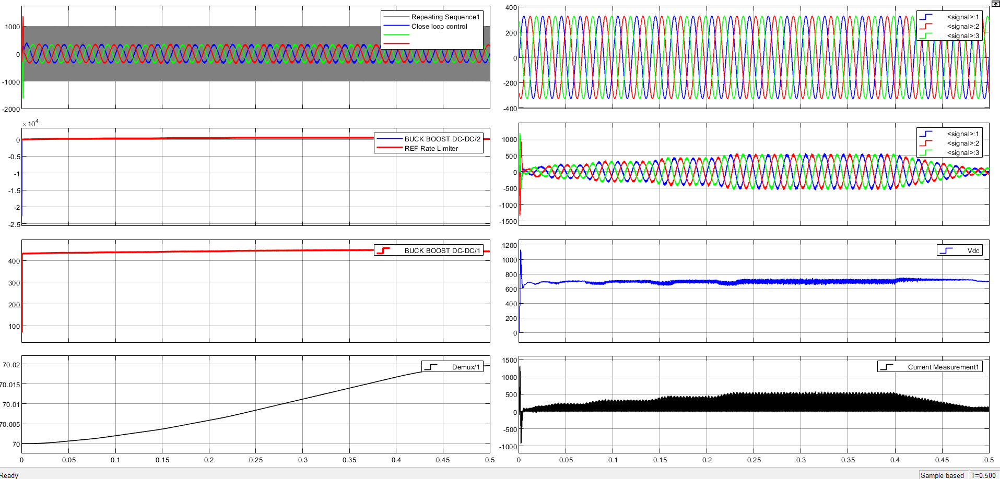
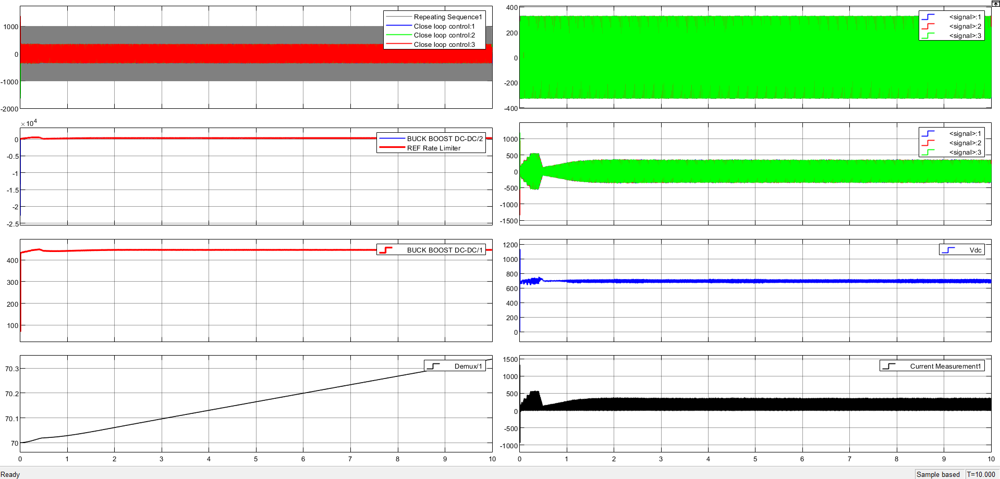
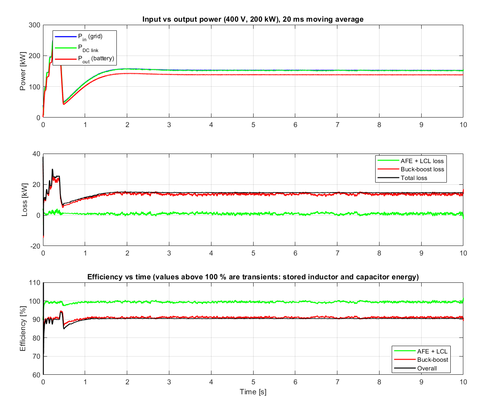

# Dual-Stage 200 kW EV Fast-Charger: Design, Modelling and Simulation

MATLAB/Simulink design of a dual-stage electric-vehicle DC fast charger with **automatic parameter calculation**: enter the grid voltage, the required charging power and the initial battery SOC, and the script sizes every component and controller gain, writes them to the Simulink model, runs it, and reports efficiency and grid power factor.

- **Stage 1:** three-phase Active Front End (AFE) rectifier with LCL filter, voltage-oriented control (VOC), 10 kHz SPWM
- **Stage 2:** synchronous buck-boost DC/DC converter (100 kHz) charging a 100 kWh / 400 V / 250 Ah Li-ion battery in CC/CV mode (up to 2C = 500 A)

R&D internship project, Department of Electronics & Electrical Engineering, MIT Manipal.
**Author:** Ayman Hazem ElShazly · **Supervisor:** Dr. Anjan N Padmasali

<p align="center">
  
</p>

## Repository structure

```
ev-charger-dual-stage/
├── src/
│   └── charger_design_RAMP_v3.m        # design + simulation + efficiency/PF script
├── model/
│   └── SYSTEM_MODEL_param_RAMP_SOC.slx # parametric Simulink model
├── docs/
│   ├── EV_Charger_Report_V3.pdf        # full report (4 cases, appendices)
│   └── EV_Charger_Presentation.pptx    # slides
├── images/                             # figures used in this README
├── results/
│   └── power_efficiency.png            # example output of the script
├── .gitignore
└── README.md
```

## Requirements

- MATLAB with **Simulink** and **Simscape Electrical** (no other toolboxes)
- The model uses a variable-step `ode45` solver with a 3 µs discrete `powergui`

## Quick start

1. Clone the repo and open MATLAB in the repository root.
2. Put the model on the path and run the script:

   ```matlab
   addpath('model');
   run('src/charger_design_RAMP_v3.m');
   ```
3. Answer the prompts (press Enter for the default):

   | Prompt | Default | Notes |
   |---|---|---|
   | Grid line-to-line RMS voltage [V] | 400 | 50 Hz grid |
   | Required charging power [kW] | 200 | capped at 200 kW (battery is 2C) |
   | Initial battery SOC [%] | 70 | 0 to <100 |
   | Run the simulation now? | y | |
   | Simulation stop time [s] | 0.5 | |

The script prints every calculated variable with its unit and formula, runs the design checks, writes the variables to the base workspace, simulates, and then prints power, efficiency and grid power factor and saves `power_efficiency.png` in the current folder.

> Tip: if a change seems to have no effect, run `bdclose all` first. A model already open under the same name can hide edits.

## What the script calculates

| Block | Variables |
|---|---|
| DC link | `Vdc` (1.2 × √2·V<sub>LL</sub>, rounded up to 50 V), `Cdc` (10 % ripple) |
| LCL filter | `L`, `Lf`, `Cf`, `Lt`, `R`, `Rf`, resonant frequency check (6·Fs < Fres < 0.5·Fsw) |
| AFE control | current-loop `kpi`, `kii` (fc = min(Fsw/10, Fres/2.5)); DC-link loop `kpv`, `kiv` (150 Hz); `Kmod` and modulation index |
| Buck-boost | `Io_max`, `Dmax`, `Dlim`, `Lch`, `Co`, peak inductor current, switch stress, `kpb`, `kib`, CV target `Vcv` |

Method references: Liserre *et al.* (LCL design), TI SLVA721A (inverting buck-boost). See the report for the full list.

## Model overview

| | |
|---|---|
|  |  |
| Grid + LCL filter | AFE rectifier (IGBT bridge, 10 kHz PWM) |
|  |  |
| AFE voltage-oriented control (PLL, dq PI loops) | Synchronous buck-boost converter |

**Charging profile:** the current reference follows a CC staircase of 40/60/80/100 % of `Io_max`, then switches to CV (447 V) at t = 0.4 s. A start-up ramp and a rate limiter on the reference reduce the DC-link overshoot at the CC→CV transition from about 1000 V to 700–750 V.

| Without ramp | With ramp |
|---|---|
|  |  |

## Results

Four cases were simulated (the first three at 400 V / 200 kW as requested by the supervisor, the fourth at a different operating point to show that the design adapts):

| | Case 1 | Case 2 | Case 3 | Case 4 |
|---|---|---|---|---|
| Grid / power | 400 V / 200 kW | 400 V / 200 kW | 400 V / 200 kW | 220 V / 60 kW |
| Simulation time | 5 s | 10 s | 3 s | 0.5 s |
| Initial SOC | 80 % | 70 % | 90 % | 70 % |
| SOC change | +0.134 % | +0.337 % | +0.060 % | +0.007 % |
| Battery power (CC window) | 225.1 kW | 223.6 kW | 227.6 kW | 69.0 kW |
| AFE + LCL efficiency | 99.6 % | 99.2 % | 99.5 % | 98.5 % |
| Buck-boost efficiency | 90.3 % | 90.7 % | 90.5 % | 94.0 % |
| Overall efficiency | 90.0 % | 90.0 % | 90.0 % | 92.7 % |
| True power factor | 0.999 | 0.999 | 0.999 | 0.988 |
| Displacement power factor | 1.000 | 1.000 | 1.000 | 1.000 |
| Current THD | 4.3 % | 4.3 % | 4.2 % | 15.5 % |

Efficiency and power factor are averaged over 0.25–0.38 s and 0.25–0.37 s respectively. The SOC change is small because a 250 Ah battery is only charged for a few seconds.




Full scopes, tables and the command-window printouts for all cases are in [`docs/EV_Charger_Report_V3.pdf`](docs/EV_Charger_Report_V3.pdf).

## Known limitations

- **Power above the request:** the battery receives about 224 kW (grid about 249 kW) at the 200 kW setting, because `Io_max = P / 400 V` is sized with the nominal voltage while the terminal voltage is about 447 V. Sizing with `Vcv` would give the requested power.
- **Low-voltage operation (220 V / 60 kW):** DC-link ripple is about 25 % peak-to-peak (design target 10 %) and current THD is 15.5 %. Gains were tuned and verified mainly at 400 V / 200 kW.
- **Buck-boost efficiency (~91 % at 400 V):** probably dominated by IGBT switching loss at 100 kHz; this was not isolated by a loss breakdown. A SiC module would be a better fit.
- **Switch stress:** 1200 V / 900 A exceeds a single 1200 V / 600 A module, so paralleled or higher-rated devices are needed in hardware.
- **Battery block** is fixed at 400 V / 250 Ah, so the maximum power is 200 kW.
- **Damping resistor** in the model is 2 Ω; the design equation gives about 0.11 Ω (effect not evaluated).
- **Start-up transient** at t = 0 (a few ms); delaying PWM enable until the PLL locks is the proposed fix.
- Efficiency counts only modelled losses (no core loss, dead time, gate drive, battery internal loss), so hardware numbers will be lower.

## Documentation

- 📄 [Full report (PDF)](docs/EV_Charger_Report_V3.pdf)
- 📊 [Presentation (PPTX)](docs/EV_Charger_Presentation.pptx)

## Citation

If this work is useful to you, please reference it as:

> A. H. ElShazly, "Design, Modelling and Simulation of a Dual-Stage EV Fast-Charging System with Automatic Parameter Calculation," R&D Internship Report, Dept. of Electronics & Electrical Engineering, MIT Manipal, supervised by Dr. A. N. Padmasali, Oct. 2026.
